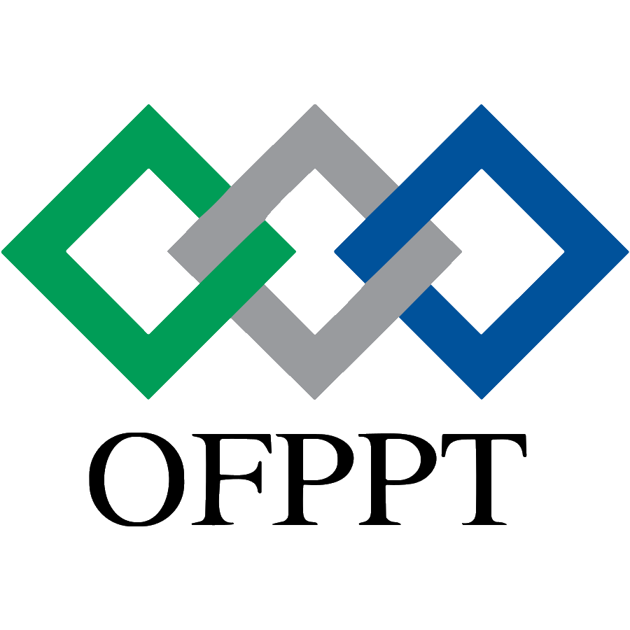

<!-- _class: title-slide -->

# Rapport de projet e-learning platforme

  
  

Aymane salmoune  
encadrant : Fouad ESSARAJ

---

## Remerciements

---

## Introduction

---

## Contexte du projet

---

## Objectif de formation (Solicode)

---

## Cahier des charges

---
<!-- _class: image-only -->

## Scrum

---
<!-- _class: image-only -->

## Processus 2TUP

---
<!-- _class: image-only -->

## Design Thinking

---

## Planification

---

## Branche fonctionnelle

---

## Carte d'empathie

---

## Définition du problème

---

## Idéation

---

## Diagramme de cas d'utilisation

---

## Stack technologique

- **Backend** · PHP 8.2 · Laravel 12
- **Autorisations** · Spatie Laravel Permission
- **Mobile** · NativePHP
- **Frontend** · Blade · Tailwind CSS · Alpine · Preline · Vite
- **Base de données** · MySQL
- **Diagrammes** · Mermaid · PlantUML

---

## Architecture

**Présentation** → **Logique métier** → **Accès aux données**

Navigateur · HTML / JavaScript

↓ API HTTP / JSON

PHP · Services · DAO

↓

Fichier JSON

---

## Prototype musical

- Genres · Artistes · Morceaux
- Création · Consultation · Modification · Suppression
- Statut · Brouillon ou publié
- Couvertures · Fichiers audio

---

## Relations des données

- **Artiste** → plusieurs morceaux
- **Genre** → plusieurs morceaux
- **Morceau** → un artiste + un genre

---

## Structure technique

- **Frontend** · HTML · CSS / Tailwind · JavaScript
- **Backend** · PHP · Contrôleurs · Services · DAO
- **API** · REST
- **Données** · MySQL / MariaDB · prototype JSON

---

## Diagramme de classes

---

## Maquettes

---

## Interfaces

---

## Conclusion

- Prototype CRUD fonctionnel
- Base pour une plateforme musicale évolutive
- Extensions possibles · authentification · upload audio · gestion complète
