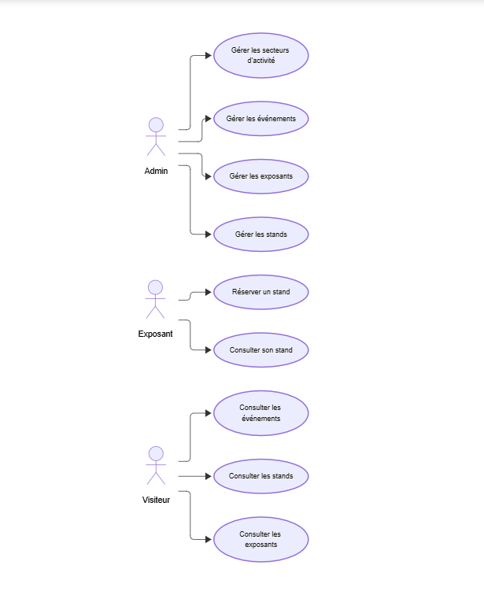

## Diagramme de cas d'utilisation:

Le diagramme de cas d’utilisation présente les fonctions principales du système et les interactions entre les acteurs et l’application de gestion des salons et foires. Il permet de définir les besoins fonctionnels, d’identifier les services attendus et de structurer les processus de gestion des événements, des stands et des exposants.

*Figure : Diagramme de cas d’utilisation de l’application de gestion des salons et foires*

### Acteurs du système

- Administrateur : gère les événements, les stands et les informations générales de l’application.
- Exposant : consulte les événements disponibles, réserve des stands et suit son statut de réservation.
- Visiteur : consulte les salons et foires, recherche les événements et découvre les exposants.
- Responsable d’événement : organise les salons, valide les réservations et contrôle la disponibilité des stands.

### Cas d’utilisation principaux

| Cas d’utilisation | Acteur | Description |
| --- | --- | --- |
| Gérer les événements | Administrateur, Responsable d’événement | Créer, modifier, consulter et supprimer les salons ou foires. |
| Gérer les stands | Administrateur, Responsable d’événement | Ajouter, modifier, consulter et supprimer les stands d’un événement. |
| Vérifier la disponibilité des stands | Administrateur, Responsable d’événement | Consulter l’état d’un stand (disponible, réservé, occupé). |
| Réserver un stand | Exposant | Sélectionner un stand disponible et effectuer une réservation. |
| Consulter les détails d’un événement | Exposant, Visiteur | Obtenir les informations sur le salon, la date, le lieu et les exposants participants. |
| Rechercher un exposant ou un secteur d’activité | Visiteur, Exposant | Trouver un exposant, un type de secteur ou un stand selon les critères recherchés. |
| Gérer les exposants | Administrateur | Enregistrer les informations des entreprises et leurs coordonnées. |
| Associer un exposant à un stand | Administrateur, Responsable d’événement | Lier un exposant à un stand réservé selon les règles de disponibilité. |
| Suivre les réservations | Exposant, Responsable d’événement | Consulter le statut de sa demande ou valider une réservation. |

### Relations entre les cas d’utilisation

- Un administrateur peut gérer les événements, les exposants et les stands.
- Un exposant peut consulter les événements et réserver un stand disponible.
- Un responsable d’événement valide les demandes de réservation et contrôle la disponibilité des emplacements.
- Un visiteur peut seulement consulter les événements et les informations associées, sans modifier les données du système.

### Règles métier principales

- Un stand ne peut être réservé que s’il est disponible.
- Un exposant peut réserver un ou plusieurs stands selon les capacités de l’événement.
- Un stand appartient à un seul événement.
- Un événement contient plusieurs stands.
- Un exposant appartient à un secteur d’activité précis.
- La réservation ou l’attribution d’un stand doit être validée avant confirmation définitive.

### Bénéfices du diagramme

Ce diagramme permet de clarifier le comportement attendu de l’application, de faciliter la compréhension des fonctionnalités par les utilisateurs et les développeurs, et de servir de base à la conception détaillée des classes, des interfaces et des traitements du système.
