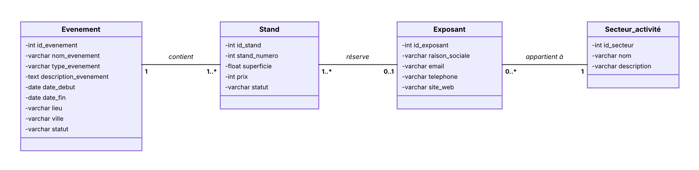

## Diagramme de class:

Le diagramme de classes présente la structure des données de l’application de gestion des salons et foires. Il découle de l’analyse fonctionnelle (diagramme de cas d’utilisation) et des choix techniques présentés précédemment. Il définit les classes principales du système, leurs attributs et les relations qui les unissent.

*Figure : Diagramme de classes de l’application de gestion des salons et foires*

### Description des classes

| Classe | Rôle | Attributs principaux |
| --- | --- | --- |
| Evenement | Représente un salon ou une foire | nom, type, description, dates de début et de fin, lieu, ville, statut |
| Stand | Espace réservable lors d’un événement | numéro, superficie, prix, statut (disponible ou réservé) |
| Exposant | Entreprise qui réserve un ou plusieurs stands | raison sociale, email, téléphone, site web |
| Secteur_activité | Domaine d’activité d’un exposant | nom, description |

### Relations entre les classes

- Un événement contient un ou plusieurs stands ; un stand appartient à un seul événement.
- Un exposant réserve un ou plusieurs stands ; un stand est réservé par au plus un exposant à la fois.
- Un exposant appartient à un seul secteur d’activité ; un secteur d’activité regroupe plusieurs exposants.

### Cardinalités

| Relation | Cardinalité |
| --- | --- |
| Evenement — Stand (contient) | 1 — 1..* |
| Exposant — Stand (réserve) | 0..1 — 1..* |
| Exposant — Secteur_activité (appartient à) | 0..* — 1 |

### Choix de conception

1. Chaque classe possède un identifiant unique (id_evenement, id_stand, id_exposant, id_secteur) qui sert de clé primaire et permet de relier les classes entre elles.
2. L’attribut statut de la classe Stand indique s’il est disponible ou déjà réservé, ce qui évite qu’un même stand soit attribué à deux exposants.
3. Le secteur d’activité est une classe distincte afin de le réutiliser pour plusieurs exposants et de faciliter le filtrage et la recherche des exposants par domaine.
4. Le numéro de téléphone est de type varchar pour conserver le zéro initial et le signe « + ».